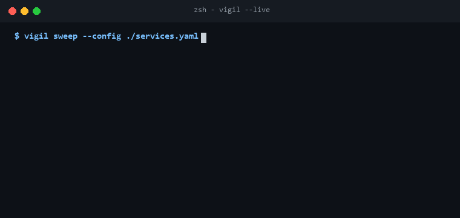

<p align="center">
  
</p>

<p align="center">
  <a href="https://github.com/Gaurav28-tech/vigil/actions"></a>
  <a href="LICENSE"></a>
  
  
</p>

<p align="center">
  <b>Vigil</b> is a zero-dependency synthetic uptime monitor and latency telemetry engine designed for microservices and cloud infrastructure. Conducts periodic HTTP/TCP synthetic sweeps, tracks latency percentiles (p50, p95, p99), triggers incident workflows, and dispatches alerts with cooldown suppression.
</p>

---

## ⚡ Live Terminal Preview

<p align="center">
  
</p>

---

## 🚀 Key Capabilities

- **Synthetic Probes**: Automated HTTP and TCP health sweeps with custom headers, expected status codes, and assertion validations.
- **Latency Telemetry**: Real-time percentiles calculation (p50, p95, p99) and moving window uptime availability.
- **Incident Lifecycle**: Automatic state transition from `HEALTHY` ➔ `DEGRADED` ➔ `OUTAGE` with configurable consecutive failure thresholds.
- **Smart Alerting**: Webhook & console dispatchers equipped with cooldown timers to eliminate notification fatigue.
- **Zero Heavy Dependencies**: Built purely with Python standard libraries for minimal runtime footprint.

---

## 🏗️ Architecture

<p align="center">
  
</p>

---

## 📦 Quickstart

### Installation

```bash
git clone https://github.com/Gaurav28-tech/vigil.git
cd vigil
```

### Basic Usage

```python
from pulse.engine import PulseMonitor
from pulse.models import ServiceConfig

monitor = PulseMonitor()

# Register service targets
monitor.register_service(
    ServiceConfig(
        id="payment-service",
        name="Stripe Payment Gateway",
        target="https://api.stripe.com/healthcheck",
        probe_type="http",
        interval_seconds=10,
        expected_status=200
    )
)

# Run synthetic sweep
results = monitor.run_sweep()
for res in results:
    print(f"Service: {res.service_id} | Status: {res.status_code} | Latency: {res.latency_ms:.2f}ms")
```

### Running Test Suite

```bash
python -m unittest discover -s tests -p "test_*.py"
```

---

## 📄 License

Distributed under the [MIT License](LICENSE).
